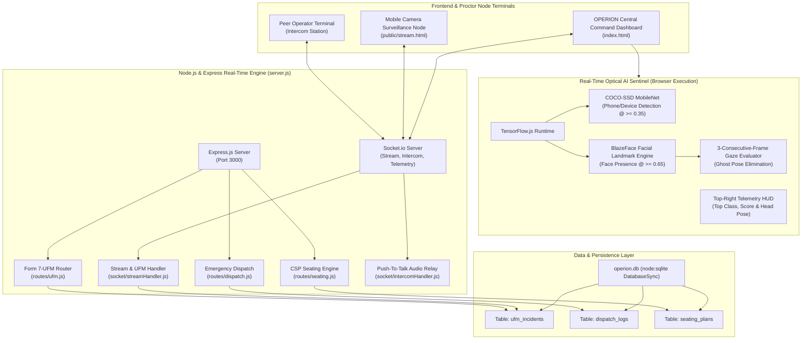

# OPERION — Apex Examination Operations & AI Surveillance Command System

[](https://nodejs.org/)
[](https://expressjs.com/)
[](https://socket.io/)
[](https://www.tensorflow.org/js)
[](https://sqlite.org/)
[](https://tailwindcss.com/)

**OPERION** is an enterprise-grade examination operations, proctor vigilance, and anti-cheating command platform. Engineered for large-scale institutional deployments (e.g. university examination wings, national entrance tests), it integrates real-time optical AI detection, strict constraint-satisfaction seating allocation, automated statutory malpractice documentation (Form 7-UFM), WebRTC-backed mobile camera relays, two-way push-to-talk tactical intercoms, and flying squad emergency dispatch.

---

## Table of Contents

- [System Architecture](#system-architecture)
- [Key Features](#key-features)
  - [1. Real-Time Optical AI Sentinel](#1-real-time-optical-ai-sentinel)
  - [2. Ghost Head Pose Elimination & Gaze Tracking](#2-ghost-head-pose-elimination--gaze-tracking)
  - [3. Strict Anti-Cheating Seating Allocation Engine (8-Way Chebyshev)](#3-strict-anti-cheating-seating-allocation-engine-8-way-chebyshev)
  - [4. Mobile Camera Surveillance Node](#4-mobile-camera-surveillance-node)
  - [5. Tactical Push-To-Talk (PTT) Intercom](#5-tactical-push-to-talk-ptt-intercom)
  - [6. Flying Squad Emergency Dispatch & Siren](#6-flying-squad-emergency-dispatch--siren)
  - [7. Persistent SQLite & Statutory Form 7-UFM Registry](#7-persistent-sqlite--statutory-form-7-ufm-registry)
- [Project Directory Layout](#project-directory-layout)
- [API Reference](#api-reference)
  - [REST Endpoints](#rest-endpoints)
  - [Socket.io Event Choreography](#socketio-event-choreography)
- [Installation & Quickstart](#installation--quickstart)
- [Automated Test Suites](#automated-test-suites)
- [Live Evaluation & Demo Guide](#live-evaluation--demo-guide)

---

## System Architecture



---

## Key Features

### 1. Real-Time Optical AI Sentinel
- **Model Stack**: Client-side inference powered by `@tensorflow/tfjs` and `@tensorflow-models/coco-ssd` (MobileNet v2 backbone).
- **Target Classes**: Scans frame captures for `['cell phone', 'remote', 'electronic device']` and related smartphone aliases.
- **Lowered Detection Threshold**: Triggers alerts at **confidence $\ge 0.35$** (lowered from default 0.60 to catch partially concealed devices).
- **Video State Guard**: Strict check against invalid or unbuffered video state (`video.readyState >= 2`, dimensions non-zero, not paused/ended).
- **Pixel-Perfect Canvas Synchronization**: Overlay canvas dimensions strictly synchronize with `video.videoWidth` and `video.videoHeight`, ensuring zero bounding box coordinate drift.
- **Glowing Red Bounding Box & HUD Label**: Renders hardware-accelerated glowing red bounding boxes with drop shadows (`shadowColor: rgba(239, 68, 68, 1)`, blur `24px`) and statutory tag banners (`MOBILE PHONE DETECTED - [conf]%`).
- **Pulsing UI Beacon Transformation**: Instantly transitions room cards on both the **Command Dashboard** and **Examination Rooms Tab** to `"UFM FLAGGED"` with red pulsing beacons (`animate-ping`).
- **4-Second Throttle Lock**: Rate-limits socket alert emissions using a strict 4-second throttle lock (`SOCKET_ALERT_THROTTLE_LOCK_MS = 4000`) to prevent socket flooding.

### 2. Ghost Head Pose Elimination & Gaze Tracking
- **Strict Face Presence Verification**: Head pose evaluation executes **strictly** when a human face is verified present with **`confidence >= 0.65`** via `@tensorflow-models/blazeface`.
- **Zero & NaN Coordinate Elimination**: If no face is detected, or coordinates are `(0, 0)` or `NaN`, the system immediately:
  - Clears all head angle states (`yaw = 0`, `pitch = 0`, `deviations = 0`).
  - Suppresses all warnings in UI and HUD.
  - Returns immediately, eliminating phantom/ghost head angles from shadows or empty chairs.
- **3-Consecutive-Frame Gaze Consistency**: Computes yaw orientation from bilateral eye-to-nose symmetry. Gaze deviation ($> 25^\circ$) must persist for **3 consecutive frames** before triggering an amber `"GAZE DEVIATION"` alert (`P2 REVIEW`). If the student returns to center, the counter immediately resets.

### 3. Strict Anti-Cheating Seating Allocation Engine (8-Way Chebyshev)
Located in [`routes/seating.js`](file:///Users/sampoorn/Desktop/Operion/routes/seating.js):
- **Constraint Satisfaction Problem (CSP)**: Two students sharing the same `(Branch + Year)` (e.g. `"CSE - 2022"`) are strictly forbidden from sitting within Chebyshev distance $D_\infty \le 1$:
  $$\max(|r_1 - r_2|, |c_1 - c_2|) \le 1$$
  Governing all 8 adjacent and diagonal directions:
  $$\{(r, c-1), (r, c+1), (r-1, c), (r+1, c), (r-1, c-1), (r-1, c+1), (r+1, c-1), (r+1, c+1)\}$$
- **Air Gap Fallback Strategy (`EMPTY BUFFER SEAT`)**: If no eligible candidate from remaining pools can be legally seated at cell $(r, c)$, the engine places an empty buffer seat (`empty: true`, `isBuffer: true`), preserving desk labeling (`A-01`, `A-02`, etc.) and column grid alignments.
- **Zero-Conflict Verification Pass**: The solver runs an automated 8-directional verification pass over the final matrix, guaranteeing **0 Chebyshev conflicts**.
- **Printable Room Seating Charts**: Generates printable hall notices and branch distribution breakdowns.

### 4. Mobile Camera Surveillance Node
Located in [`public/stream.html`](file:///Users/sampoorn/Desktop/Operion/public/stream.html):
- Captures real-time camera feeds from mobile proctors using `navigator.mediaDevices.getUserMedia`.
- Encodes frames and relays them at 20-30 FPS via Socket.io (`cctv:frame`).
- Dynamically received and rendered in the dashboard's **"Inspect Room Feed"** modal.
- Includes front/rear camera flipping, synthetic test patterns, and mobile-side UFM test emission.

### 5. Tactical Push-To-Talk (PTT) Intercom
- PeerJS / WebRTC signaling backed by Socket.io audio chunk fallback across active dashboard instances.
- Enables instant half-duplex voice communication between remote control rooms with a **Spacebar** hotkey.
- Visual audio wave bars and active speaker indicator badges.

### 6. Flying Squad Emergency Dispatch & Siren
- Connects **"Dispatch Ping"** and **"Dispatch Flying Squad"** buttons to `POST /api/dispatch`.
- Broadcasts real-time alarm payloads to all connected terminals.
- Triggers browser-synthesized dual-frequency emergency alarm sirens via the Web Audio API.

### 7. Persistent SQLite & Statutory Form 7-UFM Registry
- Backed by Node.js built-in `node:sqlite` (`DatabaseSync`) in [`database.js`](file:///Users/sampoorn/Desktop/Operion/database.js).
- When a phone is detected, an auto-drafted Form 7-UFM case is inserted with an incremental statutory docket number (e.g. `UFM/2024/019`), citing `"Smart Device / Mobile Confiscated"`.
- Clicking **"View Form 7-UFM"** opens an authentic, printable university examination malpractice report.

---

## Project Directory Layout

```
Operion/
├── index.html                   # Central Operations Dashboard frontend
├── server.js                    # Express.js + Socket.io main application server
├── database.js                  # SQLite database layer using node:sqlite DatabaseSync
├── operion.db                   # SQLite database file (auto-initialized)
├── package.json                 # Project dependencies and npm scripts
├── public/
│   ├── stream.html              # Mobile camera transmitter client
│   └── sample_students.csv      # Sample multi-branch candidate registry with 'year'
├── routes/
│   ├── ufm.js                   # REST endpoints for Form 7-UFM records & stats
│   ├── seating.js               # 8-Directional Chebyshev CSP seating generator
│   ├── dispatch.js              # Flying squad emergency dispatch routes
│   └── operational.js           # Student & faculty registry telemetry routes
├── socket/
│   ├── streamHandler.js         # Mobile camera frame relay & AI ufm_alert receiver
│   └── intercomHandler.js       # Two-way Push-To-Talk (PTT) audio signaling
├── test_features.js             # Automated integration test suite (22 tests)
└── test_refactored_sentinel.js  # Refactored AI surveillance test suite (30 tests)
```

---

## API Reference

### REST Endpoints

| Method | Endpoint | Description |
|---|---|---|
| `GET` | `/api/ufm` | List all Form 7-UFM incidents with active/resolved counts |
| `GET` | `/api/ufm/:docket_no` | Get full details for a specific Form 7-UFM docket |
| `POST` | `/api/ufm` | Register a new Form 7-UFM incident record |
| `PATCH` | `/api/ufm/:docket_no/status` | Update case status (`UNDER_INVESTIGATION`, `RESOLVED`, etc.) |
| `POST` | `/api/dispatch` | Deploy Flying Squad or send patrol ping with priority |
| `GET` | `/api/dispatch` | Fetch recent emergency dispatch logs |
| `POST` | `/api/seating/generate` | Generate 8-directional Chebyshev anti-cheating seating matrix |
| `GET` | `/api/seating/sample` | Download or inspect 30-candidate sample CSV with `year` column |
| `GET` | `/api/students` | Get seated candidate registry |
| `GET` | `/api/faculty` | Get faculty invigilation duty rosters |
| `GET` | `/openapi.json` | OpenAPI 3.0 specification for health and API status |

#### Sample Seating Generation Request (`POST /api/seating/generate`)
```json
{
  "hall_name": "Room 501-LHS (Block E)",
  "rows": 5,
  "cols": 6,
  "csv": "roll_no,name,branch,paper_code,year\n22CSE001,Aarav Sharma,CSE,CS-402,2022\n22ECE001,Diya Kapoor,ECE,EC-301,2022..."
}
```

---

### Socket.io Event Choreography

| Event Name | Direction | Payload Structure | Description |
|---|---|---|---|
| `ufm_alert` | Client $\rightarrow$ Server $\rightarrow$ All | `{ room_id, detected_object, confidence, timestamp, snapshot_url }` | Real-time AI detection alert; triggers auto-docketing & UI alarms |
| `ufm:created` | Server $\rightarrow$ All | Incident object with statutory `docket_no` | Broadcasts newly drafted Form 7-UFM record |
| `cctv:frame` | Mobile $\rightarrow$ Server $\rightarrow$ Dashboard | `{ room, corner, frame: "data:image/jpeg;base64,...", fps }` | Live mobile camera frame relay |
| `dispatch:alarm` | Server $\rightarrow$ All | `{ dispatch_id, hall, type, priority, message }` | Dispatches Flying Squad and sounds synthesizer siren |
| `intercom:join` | Client $\rightarrow$ Server | `{ name, role }` | Registers workstation on tactical intercom line |
| `intercom:ptt` | Client $\rightarrow$ Server $\rightarrow$ Peers | `{ talking: true/false, name }` | Push-to-talk transmission state broadcast |
| `intercom:audio_chunk`| Client $\rightarrow$ Server $\rightarrow$ Peers | `{ audio: "data:audio/webm;base64,...", senderName }` | Audio chunk transmission between terminals |

---

## Installation & Quickstart

### Prerequisites
- **Node.js**: `v20.0.0` or higher (tested on Node.js `v26.10.0`).
- Modern web browser (Google Chrome, Microsoft Edge, Firefox, or Safari) with camera/microphone permissions enabled for WebRTC features.

### 1. Clone & Install Dependencies
```bash
cd Operion
npm install
```

### 2. Start the Server
```bash
npm start
```
*The server boots on port 3000 and automatically initializes `operion.db` with SQLite schemas.*

```
=======================================================
  OPERION Exam Operations System Online on Port 3000
  Dashboard:  http://localhost:3000
  Mobile Cam: http://localhost:3000/stream.html
  REST APIs:  http://localhost:3000/api/ufm
=======================================================
```

### 3. Open the Dashboards
- **Central Operations Command Dashboard**: [http://localhost:3000](http://localhost:3000)
- **Mobile Camera Node Transmitter**: [http://localhost:3000/stream.html](http://localhost:3000/stream.html)
- **OpenAPI Health Spec**: [http://localhost:3000/openapi.json](http://localhost:3000/openapi.json)

---

## Automated Test Suites

OPERION includes two comprehensive automated verification test suites covering all REST APIs, CSP seating math, WebSocket relays, and AI pipeline rules.

### Run All Tests
```bash
node test_features.js
node test_refactored_sentinel.js
```

### Test Suite 1: Core System & Seating Verification (`test_features.js`)
- Validates `/api/seating/sample` format and `year` column.
- Generates 30-desk 8-directional Chebyshev matrix; executes automated 8-neighbor scan verifying **0 conflicts**.
- Verifies `EMPTY BUFFER SEAT` air gap placement when constraints prevent student assignment.
- Connects live Socket.io client, emits `ufm_alert`, confirms SQLite persistence, auto-docket assignment (`UFM/2024/...`), and statutory citation.
- **Result**: `22 Passed, 0 Failed`.

### Test Suite 2: AI Sentinel Refactor Verification (`test_refactored_sentinel.js`)
- Validates target classes `['cell phone', 'remote', 'electronic device']`.
- Validates lowered confidence threshold ($0.35$).
- Validates video state guard (`video.readyState >= 2`).
- Validates 1:1 canvas coordinate synchronization (`overlayCanvas.width = video.videoWidth`).
- Validates Ghost Head Pose Elimination ($\ge 0.65$ face confidence, state reset on $(0,0)/\text{NaN}$, warning suppression).
- Validates 3-consecutive-frame requirement for amber `"GAZE DEVIATION"` alerts.
- Validates 4-second throttle lock on socket emissions under rapid burst attempts.
- **Result**: `30 Passed, 0 Failed`.

---

## Live Evaluation & Demo Guide

Follow these steps to demonstrate and test all features directly in the UI:

### 1. Test Real-Time Mobile Phone Detection
1. Open [http://localhost:3000](http://localhost:3000).
2. On the **Room 501-LHS** card, click **"Inspect Room Feed"**.
3. Click **"Start Local Camera Feed"** to authorize your webcam (or use the simulated feed).
4. Click **`⚡ Simulate Mobile (0.35+)`** (or hold up a smartphone or remote to your webcam).
5. **Observed Behavior**:
   - High-contrast glowing red bounding box and label `"MOBILE PHONE DETECTED - [conf]%"` appear on the video viewport.
   - The top-right Telemetry HUD displays `TOP CLASS: CELL PHONE` and updates the confidence score.
   - Room 501 transforms to **`UFM FLAGGED`** with a pulsing red beacon.
   - A dual-frequency siren alarm sounds.
   - An auto-drafted Form 7-UFM appears in the **"UFM Cases & Cheating Discrepancies"** tab citing `"Smart Device / Mobile Confiscated"`.

### 2. Test Ghost Head Pose Elimination & Gaze Tracking
1. Inside the CCTV Inspection Modal, click **`👁 Gaze Deviation (3-Frame)`**.
2. **Observed Behavior**:
   - Frames 1 and 2 display evaluation progress; alerts are suppressed.
   - On Frame 3, an amber reticle and banner display **`GAZE DEVIATION`** (`P2 REVIEW`).
   - The Telemetry HUD updates `HEAD POSE: GAZE DEVIATION`.
3. Click **`Ghost Pose Suppress`** to verify that missing faces or invalid coordinates immediately clear angle states and suppress warnings.

### 3. Test Strict 8-Way Anti-Cheating Seating Engine
1. Click the **"Anti-Cheating Seating Plan"** tab in the top navigation bar.
2. Click **"Load 4-Branch Sample Data"** (loads candidates with CSE, ECE, ME, CE and multiple batches).
3. Click **"Generate Anti-Cheating Seating Plan"**.
4. **Observed Behavior**:
   - A 2D interactive matrix renders desks `A-01` to `E-06`.
   - No two adjacent desks (left, right, front, back, or diagonals) share the same `(Branch + Year)`.
   - Constrained desks render as distinct grey/dashed **`EMPTY BUFFER SEAT`** cards.
   - The summary banner confirms **`0 Conflicts ● Strict 8-Directional Chebyshev Air Gap Verified`**.
   - Click **"Print Official Seating Chart"** to preview print-ready hall door charts.

### 4. Test Mobile Node Camera Streaming
1. Open [http://localhost:3000/stream.html](http://localhost:3000/stream.html) on a second browser tab or mobile phone on the same network.
2. Tap **"Start Camera Stream"** (or toggle simulation).
3. Return to the dashboard at [http://localhost:3000](http://localhost:3000) and click **"Inspect Room Feed"**.
4. The live remote mobile video frames appear in real time over Socket.io.

### 5. Test Push-To-Talk Intercom
1. Click the **Intercom** button in the header.
2. Hold down the **Spacebar** (or click and hold **"HOLD TO TALK"**).
3. The mic meter animates and audio streams to all connected dashboard instances.

---

## License

OPERION is released under the **MIT License**. Copyright © 2024-2026 Chandigarh University Examination Authority & OPERION Core Systems Team.
